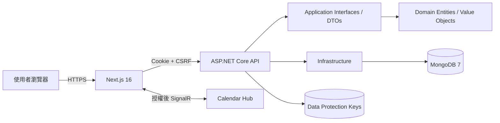
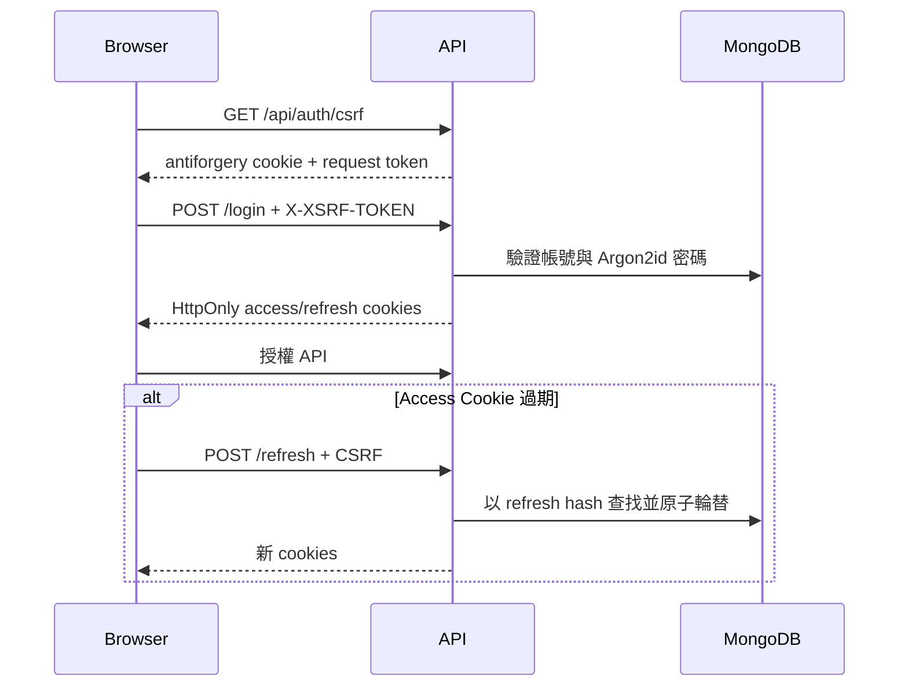

# 系統與架構全覽

## 產品定位

許氏入口網整合家族成員、行事曆、農曆／祭祀資訊、行程及即時事件通知。第一任管理員為許浴宸，介面與文化資料採繁體中文及台灣使用情境。

## 技術組合

| 層次 | 技術 | 用途 |
|---|---|---|
| Web | Next.js 16、React 19、TypeScript 5、Tailwind CSS 4、shadcn/ui | 頁面、互動與設計系統 |
| 前端資料 | TanStack Query 5、Zustand 5、React Hook Form 7、Zod 4 | Server state、session UI state、表單驗證 |
| API | .NET 10 ASP.NET Core Controllers | REST API、認證、授權與 middleware |
| 即時服務 | SignalR | 行事曆事件即時更新 |
| 資料庫 | MongoDB 7、C# Driver 3.7 | 家族與行程文件資料 |
| 密碼 | Argon2id | 抗暴力破解的密碼雜湊 |
| 部署 | Docker Compose、GitHub Actions | 可重現部署與持續整合 |

## 架構邊界

後端遵循 Domain → Application → Infrastructure／API 的依賴方向。Domain 不依賴業務外部框架；資料存取透過 Repository 介面；API 負責 HTTP、Cookie、CSRF 與 DI 組裝。

## 核心功能

- 認證：登入、Refresh Token rotation、登出、管理員建立帳號、取得目前使用者。
- 家族成員：查詢、新增、修改、刪除。
- 行事曆：事件 CRUD、農曆資訊與即時通知。
- 行程：查詢、新增、修改、刪除。
- 健康檢查：`/health/live` 檢查程序存活；`/health/ready` 檢查 MongoDB readiness。

## 認證流程

Refresh Token 原文只存在瀏覽器 HttpOnly Cookie；MongoDB 僅保存 SHA-256 hash。舊 token 再次出現時會撤銷整個 token family。

## 資料與索引

主要集合為 Users、Members、Events、Itineraries。啟動時由 `MongoDbIndexInitializer` 冪等建立索引；容器啟動時另以一次性服務確認最小權限 `familyportal_app` 帳號，支援既有 volume 升級。

## CI 品質閘門

- Backend：restore、Release build、xUnit 測試、coverage collector。
- Frontend：鎖檔安裝、ESLint、TypeScript 與 Next.js production build。
- 2026-07-23 GitHub Actions run `30022585388` 全部通過。
