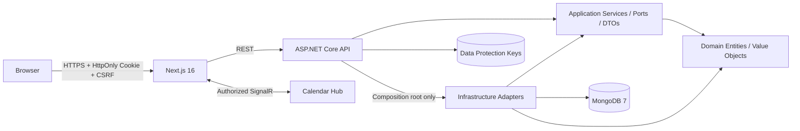
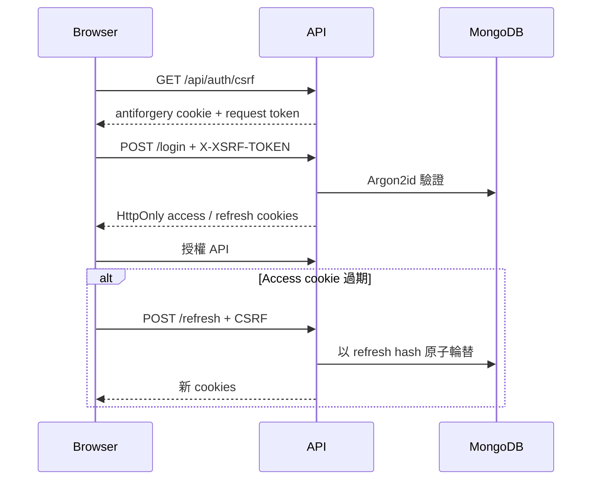

# 許氏入口網系統與架構全覽

## 產品定位

許氏入口網整合家族成員、行事曆、農曆／祭祀資訊、行程及即時事件通知。第一任管理員為「許浴宸」；UI 與文化資料採繁體中文及台灣情境。

## 技術組合

| 層次 | 技術 | 角色 |
|---|---|---|
| Web | Next.js `16.2.11`、React 19、TypeScript 5 strict、Tailwind CSS 4、shadcn/ui | App Router、互動 UI、設計系統 |
| 前端資料 | TanStack Query 5、Zustand 5、React Hook Form 7、Zod 4 | Server state、登入 UI state、表單驗證 |
| API | .NET 10／ASP.NET Core Controllers | REST、認證、授權、CSRF、rate limit、health checks |
| Application | C# Services／Interfaces／DTOs | Use cases、mapping、validation、通知抽象 |
| Infrastructure | MongoDB Driver 3.7.1、Argon2id、JWT、SignalR adapter | 資料、密碼、token、realtime 實作 |
| Database | MongoDB 7.0.23 | Users、Members、Events、Itineraries |
| 部署與 SDLC | Docker Compose、Caddy、GitHub Actions、CodeQL、Trivy | TLS edge、可重現部署、供應鏈 gate |

## Clean Architecture 邊界

依賴規則：

- Domain 不依賴 Application、Infrastructure 或 API；只保留既有 MongoDB BSON 標注。
- Application 只參考 Domain。
- Infrastructure 實作 Application ports。
- API 只在 composition root 組裝 Infrastructure；Controllers 只依賴 Application services。
- `ArchitectureDependencyTests` 會掃描所有 Controllers，並排除 USB／macOS 產生的 AppleDouble `._*` sidecar，避免假失敗或漏掃。

## 核心 Use Cases

- `AuthService`：登入、refresh rotation、replay detection、登出、管理員建立帳號、目前使用者。
- `EventService`：事件查詢／CRUD、日期與農曆 mapping、通知發布。
- `MemberService`：成員查詢／CRUD、舊資料相容與農曆生日正規化。
- `ItineraryService`：有界查詢、游標分頁、CRUD 與參與者 mapping。
- `ICalendarNotifier`：Application 不認識 SignalR；Infrastructure adapter 負責廣播。

## 認證與 CSRF 流程

`AddControllersWithViews` 會註冊 MVC antiforgery 所需服務；全域 `AutoValidateAntiforgeryTokenAttribute` 保護非安全 HTTP methods。Refresh Token 原文只存在 HttpOnly Cookie，MongoDB 只保存 hash；歷史保留有界，重放會撤銷同 family。

## Request Pipeline

核心順序為：Forwarded Headers → HTTPS → CORS → Authentication → Rate Limiter → Authorization。一般 limiter 以 immutable `NameIdentifier` 分區，匿名／登入前流量才退回可信 proxy 處理後的 IP；Kestrel 與 Caddy 都限制 request body 為 1 MiB。

## 前端可靠性與可及性

- Admin UI gating 與後端 `AdminOnly` 雙層一致；前端不是安全邊界。
- skip link、main landmark、`aria-current`、表單 label／error 關聯、autocomplete 與 reduced-motion 已補齊。
- 台灣國曆／農曆節日採明確 allowlist，不再直接顯示不適合台灣的套件內建節日。
- 共用 `SharedSignalRClient` 管理單一連線、reference count、StrictMode remount、登入狀態、重連、離線狀態與 React Query resync。
- route error recovery、retry policy、Confirm Dialog 與 Connection Status 有元件測試。

## 部署拓撲

| 模式 | 對外暴露 | 安全定位 |
|---|---|---|
| `docker-compose.yml` | Frontend／API 僅 loopback | 本機 Development；Cookie Secure 關閉僅限 localhost |
| `docker-compose.production.yml` | 只有 Caddy `80/443` | Production；API／Frontend 僅內網 expose，Secure Cookie、HTTPS origins、固定 proxy IP |
| MongoDB | 不發布 `27017` | app user 僅 FamilyPortal DB `readWrite`；root 只供初始化／管理 |

正式設定不符合 Secure Cookie 或 HTTPS origin 時，API 會 fail fast。Default admin 使用 duplicate-safe insert；若 unique identifier 與非管理員衝突會中止，而不是誤報成功。

## 自動化品質閘門

- Backend：restore、5-project NuGet vulnerable audit、Release build、xUnit v3 MTP、最低 150 tests、Cobertura artifact。
- Frontend：本機 Vitest `54/54`；CI 執行 frozen lockfile、production audit、Vitest、ESLint 與 Next.js production build。
- Supply chain：Trivy High／Critical 阻擋、CycloneDX SBOM artifact、Dependabot。
- Static analysis：C# 與 JavaScript／TypeScript CodeQL，含每週排程。

> Frontend regression tests 已納入 workflow；GitHub branch protection 仍需在 repository settings 將對應 job 設為 required check。

## 資料保護原則

- 本輪沒有 drop、清空 collection 或刪除 Mongo volume。
- 新 validation 限制未批次重寫既有 MongoDB documents；讀取層保留舊資料相容。
- 索引建立與 app user 初始化採冪等流程；正式變更前仍須備份與還原演練。

延伸閱讀：[風險台帳](./03-安全風險與修復台帳.md) · [部署維運](./04-部署與維運手冊.md) · [文件中心](./README.md)
