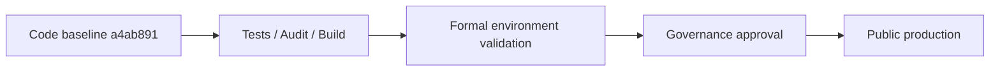

# 企業級成熟度與後續路線圖

## 評估定義

企業級不是「用了新框架」或「掃描為零」，而是能持續做到：明確邊界、secure by default、可重現驗證、供應鏈治理、可觀測營運及責任分工。

## 當前結論

本專案的**企業級工程思維與程式碼安全基線已閉環**；剩餘差距集中於正式環境及組織治理。最準確的成熟度描述是「可進入受控正式環境建置」，而不是「已取得企業生產認證」。

## 成熟度矩陣

| 能力 | 判定 | 現有證據 | 下一個成熟度條件 |
|---|---|---|---|
| 現代技術與架構 | 良好 | .NET 10、Next 16、Clean Architecture services／guards | 持續 architecture decision records |
| 身分與存取 | 良好 | fallback auth、AdminOnly、Argon2id、Cookie／CSRF、token rotation | 正式 IdP／MFA 評估、權限定期複核 |
| 應用安全 | 良好 | CSP nonce、HSTS、CORS、rate limit、input／body limits | 正式 DAST／滲透測試 |
| 供應鏈 | 良好 | NuGet／pnpm audit、CodeQL、Trivy、SBOM、Dependabot | 弱點 SLA、例外到期機制 |
| 自動化品質 | 良好 | Backend 158、Frontend 54、lint／build、最低測試數與 coverage artifact | E2E／coverage 基準與趨勢 |
| 前端 UX／a11y | 基線良好 | Admin gating、forms、skip link、reduced motion、error recovery | axe＋跨瀏覽器／實機驗收 |
| 即時可靠性 | 基線良好 | shared lifecycle、狀態、重連 resync tests | 長連線壓力與網路故障演練 |
| 資料韌性 | 待環境驗證 | 不破壞既有 Mongo 資料、冪等索引／user init | 備份還原、RPO／RTO、容量證據 |
| 可觀測性 | 待建置 | 安全 structured logging 基線 | metrics／traces／alerts／SLO |
| 組織治理 | 待制度化 | 文件、台帳、CI workflows | branch protection、CODEOWNERS、review／incident 制度 |

## 已完成的工程閉環

1. **發現：** 以架構、安全、供應鏈、UI／UX、資料與部署 skills 建立風險清單。
2. **修復：** 先關閉 Critical／High，再修正 Medium 的 boundedness、a11y、realtime 與測試假綠。
3. **防回歸：** 後端／前端測試、architecture guard、audit、CodeQL、Trivy、SBOM。
4. **可追溯：** 風險台帳、Runbook、Open Design、基準 SHA 與 Obsidian-ready Markdown。
5. **誠實邊界：** 不把本機或 CI 綠燈等同正式環境認證。

## 後續路線圖

### P0：正式公開上線核准

- 完成正式 DNS／TLS／HSTS／proxy／Cookie／CORS 外部驗證。
- Secrets 進入 Secret Manager，完成輪替與 break-glass 流程。
- 執行 MongoDB backup restore，核准 RPO／RTO。
- 建立集中 logs、metrics、traces、alerts、SLO 與值班。
- 在最終 push 後保存 CI、CodeQL、Trivy、SBOM、coverage 的 run／artifact 連結。
- 執行正式拓撲的 auth／RBAC／CRUD／SignalR E2E 與安全 smoke test。

### P1：一個迭代內的治理強化

- 啟用 branch protection、CODEOWNERS、至少一位 reviewer 與 required checks。
- 在 GitHub branch protection 將既有 Frontend CI job 設為 required check。
- 建立 pnpm Low advisory 處置紀錄與 High／Critical SLA。
- 導入 Playwright＋axe、跨瀏覽器及 mobile／tablet viewport gate。
- 從現有 Cobertura artifact 建立 project-only coverage 基準，避免被第三方 source 稀釋。
- 執行威脅模型與權限矩陣 review。

### P2：持續營運成熟

- 壓力測試 API、MongoDB、SignalR 與 nonce SSR 容量。
- 災難復原、secret compromise、dependency zero-day 與 incident tabletop drill。
- 以 SLO／錯誤預算管理可靠性，不以單次 release 綠燈取代趨勢。
- 安排獨立滲透測試與年度架構／資料治理審查。

## 管理 Gate

目前已完成 `C` 與本機 `V`；遠端最終 run、`E`、`G` 尚需補證。任何階段未通過都不應跳級宣稱完成。

## 投資建議

不建議重寫技術棧。下一筆投入應優先用在正式環境證據、資料韌性、可觀測性、E2E 與治理制度；這些才是從「企業級思維」走到「企業生產認證」的主要差距。

延伸閱讀：[管理摘要](./01-管理摘要.md) · [風險台帳](./03-安全風險與修復台帳.md) · [部署維運](./04-部署與維運手冊.md) · [文件中心](./README.md)
